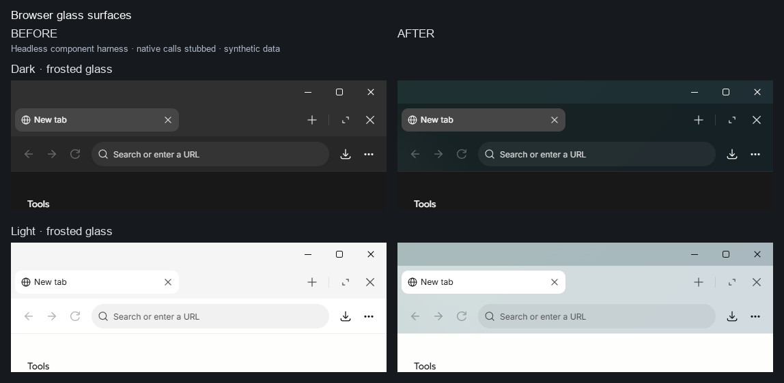

# Browser glass surfaces

Glass browser tabs and toolbar adopt the wallpaper surface; the Windows titlebar strip is clear. Standard theme chrome and document canvases remain opaque.

Base: `24d65c19ddaf0da82c4cc48b9bb67ec69f48b97a`

Head: `862f051926991b51455152205b340fa02719cfb1`

Validation: `{"states": 24, "standardThemeMaxPixelDifference": 0}`

Component harness only: native calls are stubbed, chat rows are synthetic, the footer JSX and scroll-fade function are extracted from the pinned source. The modal backdrop uses the real app's viewport attributes and opacity. No native WebView content or backend behavior is exercised. Images are fixed crops with labels; no scaling or pixel retouching. Full screenshots, measured facts and environment details are in this folder and `meta.json`.
