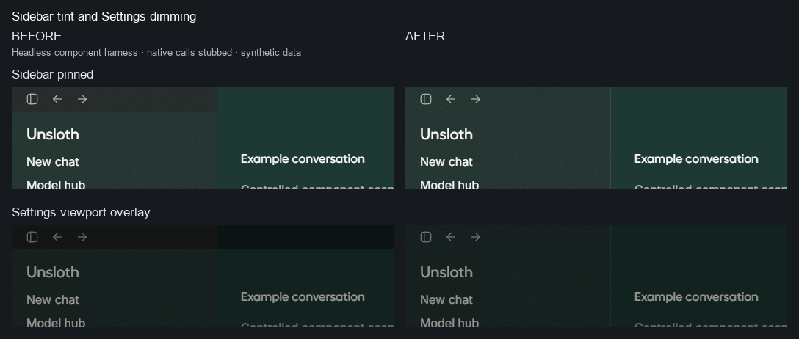

# Sidebar tint and Settings dimming

The pinned and peeking sidebar has one continuous tint through the titlebar; viewport modal dimming is applied once, with native window controls undimmed.

Base: `24d65c19ddaf0da82c4cc48b9bb67ec69f48b97a`

Head: `93e1dba296f126626993e26ec76a7e18c0582f1d`

Validation: `{"states": 96, "beforeBandMax": 46, "afterBandMax": 0, "beforeSidebarSeamMax": 54.008333333333326, "afterSidebarSeamMax": 0.4416666666666629}`

Component harness only: native calls are stubbed, chat rows are synthetic, the footer JSX and scroll-fade function are extracted from the pinned source. The modal backdrop uses the real app's viewport attributes and opacity. No native WebView content or backend behavior is exercised. Images are fixed crops with labels; no scaling or pixel retouching. Full screenshots, measured facts and environment details are in this folder and `meta.json`.
